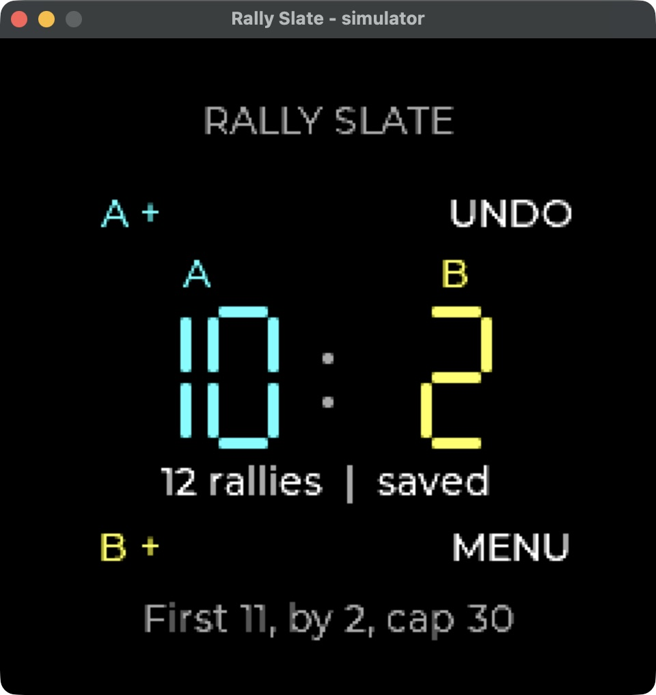

# Rally Slate

A small, offline, two-sided rally scorekeeper for UNA Watch. Add a point with a physical button; undo a mistaken point without reconstructing the round from memory. The large A/B scores use original seven-segment drawing and distinct labels as well as colors.

This is an agent-built candidate for the [October 2026 UNA app competition](https://unawatch.com/blogs/news/una-apps-competition-october-2026). It has not been entered, accepted, awarded or paid. A scorekeeper is not a new idea in general, and no claim of first-of-its-kind originality on UNA or other watches is made. No human code review, user study or actual-watch validation is claimed.

## Use

On the score screen:

- L1 adds an A point; L2 adds a B point.
- R1 undoes the most recent rally, including a winning rally.
- R2 opens the menu. L1/L2 move, R1 selects, R2 cancels or returns.

Choose a target of 11, 15 or 21. A round finishes at the target with a two-point lead, or at the hard cap of 30. These are the app's casual-round rules, not certification for an official sport. Completed rounds reject further points until undo or a new round. A new round or changed target requires explicit confirmation and clears the current history.

The app keeps the complete history of at most 59 rallies in the current round. It does not track sets, serve order, players' identities, location or health data, and has no account or network component.

## Saves and recovery

Two app-relative files alternate 76-byte records with a format version, sequence number, validated rally history and accidental-damage checksum. Each successful change writes and flushes the inactive copy before treating it as the latest save. This does not establish crash-atomic storage on actual hardware.

If one existing copy is unreadable, a valid copy can be recovered and is labeled on screen; this may roll back the latest change. If both existing copies are invalid, a new round must be explicitly confirmed. A write failure is shown as `NOT SAVED`, and exiting with unsaved changes asks for confirmation. The checksum is not authentication against malicious edits.

## Build

Use the official [UNA SDK](https://github.com/UNAWatch/una-sdk) at `d71d0dc3bad7d47282fcf5a4c53a3f0f2031afb1`, with LVGL at `85aa60d18b3d5e5588d7b247abf90198f07c8a63`. Initialize its LVGL submodule and set `UNA_SDK` for the build process. The original SDK documentation describes the architecture and packaging format.

The desktop simulator needs CMake 3.21+, a C++17 compiler, Ninja or another CMake generator, and SDL2. macOS needs the included, separately identified SDK simulator compatibility patch; it is not part of the firmware build.

```sh
cmake -S simulator -B sim-build -G Ninja -DCMAKE_BUILD_TYPE=Debug
cmake --build sim-build
./sim-build/RallySlateSimulator
```

The simulator keeps test files beneath the operating system temporary directory: `rally-slate-simulator/runtime/Output`, independent of the launcher's working directory. Diagnostic output stays under that temporary runtime folder too. On macOS, copy the actual executable and app bundle to a temporary directory before GUI testing; do not use a symlink back into Documents. This avoids requesting access to the protected Documents folder. Temporary data may be removed by the operating system and is only for testing. Optional framebuffer tracing is disabled by default (`RALLY_TRACE_FRAMES`). Keys 1–4 represent the watch buttons L1, L2, R1, R2. Press/release events are ignored for scoring; a click adds one rally.

For firmware, place an open GNU ARM toolchain on the process's PATH and create a Python environment containing the SDK packer's requirements. GNU ARM 13.x is the tested compiler family; no ST account was used. Set `UNA_PYTHON_EXECUTABLE` to that environment's Python.

```sh
cmake -S firmware -B firmware-build -G Ninja -DUNA_PYTHON_EXECUTABLE=/path/to/venv/bin/python
cmake --build firmware-build
```

The binary is written to `Output/RallySlate_0.1.0.uapp`. The default app ID `BEC65A5C096E4894` is for local development only. The official App Store flow generates its own ID: after the account and required terms step, create the app in the portal, copy that ID, reconfigure with `-DAPP_ID=YOUR_PORTAL_ID` and rebuild. Do not upload a binary carrying the default development ID.

Prepare a local preview with `python3 package_app.py --app-id BEC65A5C096E4894 --development --output rally-slate-development-preview.zip`. For a portal build, pass its ID and omit `--development`. This checks the actual binary's ID, version and CRC, uses the pinned SDK resolver for the kernel compatibility floor, and includes a matching manifest, icon and accompanying application/third-party licence texts. Preparing a ZIP does not publish it or enter the competition. A successful build does not establish watch installation, concurrent use with an activity recorder, battery use or device behavior. The GUI uses the SDK's ordinary partial-render path and an explicitly configured 64 KiB LVGL heap.

## Preview

Native macOS simulator; no actual-watch photograph or field test is implied.



Save-fault checks: [unreadable saves](docs/save-recovery.png) and [write warning](docs/write-warning.png). See [VALIDATION.json](VALIDATION.json) for the measured scope and remaining limits.

## Checks and provenance

```sh
c++ -std=c++17 -Wall -Wextra test_score.cpp -o test-score
./test-score
```

The core checks cover normal completion, deuce to the 30-point cap, complete undo, serialized round trips, every single-bit mutation in a record, rejection of semantically invalid records and sequence wrap. Native macOS simulator checks separately exercised scoring and undo, rejection of points after a win, undo of the winning point, restart persistence, cancellation of destructive menu actions, scrolling license notices, recovery from one damaged save, explicit confirmation when both saves are damaged, a visible write-failure warning, and cancellation/confirmation of unsaved exit. Fault injection used temporary test files, including directories at save filenames to force write-open failure. These checks establish local simulator behavior, not actual-watch storage or hardware behavior.

Earlier native screenshot previews appeared to omit unchanged parts of the window. Inspecting the complete saved PNG showed the missing title and labels were present. This was a diagnostic mistake, not demonstrated corruption of the app framebuffer; unnecessary full-buffer and screen-replacement changes were removed. The time spent on that investigation remains part of the unpaid attempt.

Original code and procedural launcher icons were prepared by Codex under brodyga45's direction. The service and simulator bootstrap derive from the pinned SDK HelloWorld. See [LICENSE](LICENSE) and [THIRD-PARTY-NOTICES.md](THIRD-PARTY-NOTICES.md). SDK, LVGL and Montserrat notices are included as files and in the app's scrollable Licenses menu. The candidate contains no downloaded third-party bitmap, model inference or claimed human field testing.
